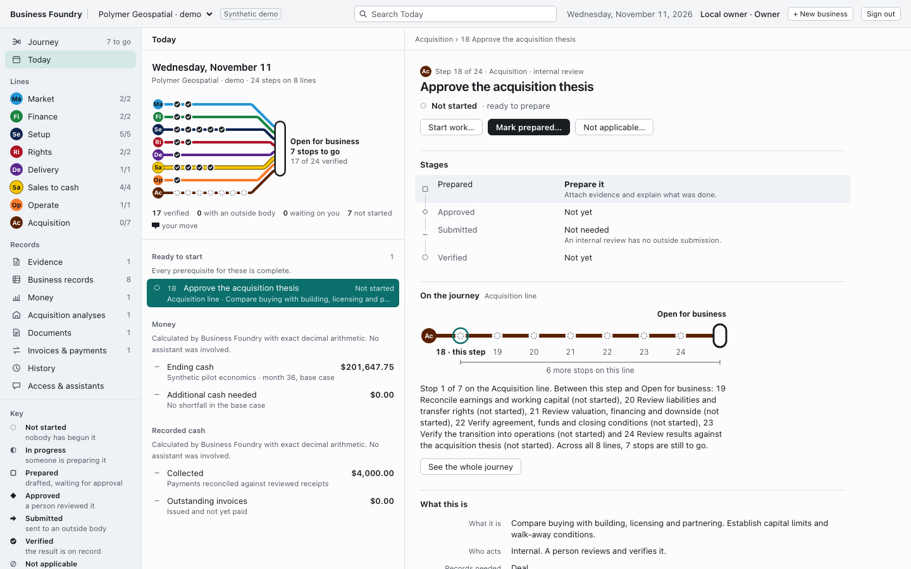

# Business Foundry

An open operating foundation for **starting, acquiring and running a business**.

Turn a concept into a connected business workspace: customers, offers, assets and rights, roles, decisions, evidence, work, financial scenarios, acquisition diligence, working documents and a first sale through payment. Starting and buying are two entry paths over the same records.

**v0.1 is a working local-first alpha.** It prepares and tracks real work with human review. Government filings, bank onboarding, signatures and payments happen with the relevant providers; Foundry records their receipts. It does not certify legal compliance or replace legal, tax, accounting or investment judgment.



## Run it

Requires Python 3.11+ and [uv](https://docs.astral.sh/uv/getting-started/installation/).

```sh
git clone https://github.com/calgulbenkian/business-foundry.git
cd business-foundry
uv sync --locked
uv run foundry init
uv run foundry demo
uv run foundry serve
```

Open **http://127.0.0.1:8765**, retrieve your private sign-in key with `uv run foundry token`, and paste it into the sign-in screen. The application works without an AI subscription or API key. Skip `demo` for an empty workspace.

The Polymer Geospatial example is **explicitly synthetic**. Its concept, customers, figures, receipts and completed steps are demonstration fixtures. They do not describe or certify Polymer's actual business.

Alternative: `python -m venv .venv`, activate it, `pip install .`, then use `foundry` directly.

### Desktop window (preview)

```sh
uv sync --locked --extra desktop
uv run foundry-desktop
```

This opens the same interface in a native window and signs you in automatically: there is no key to paste. Records are kept in your per-user application data folder (`~/Library/Application Support/Business Foundry` on macOS, `%LOCALAPPDATA%\Business Foundry` on Windows, `~/.local/share/Business Foundry` on Linux unless `XDG_DATA_HOME` names another folder), not in the folder you launched from. The command-line tools can use that database with `--db`. To back it up on macOS, run `uv run foundry --db "$HOME/Library/Application Support/Business Foundry/foundry.db" backup /private/path/backup.db` from the folder you start the app from, with `/private/path/backup.db` changed to a private place for the backup. The window shows the backup command for the database it has open, including one chosen with `--data-dir`, on its **Access & assistants** page, in **Your business records**, under **Backup and restore**; on Windows it shows the path but no ready command. Windows needs the Microsoft Edge WebView2 Runtime. Only one copy of the app can be open at a time for each data folder. If you choose **Sign out** inside the window, the sign-in screen appears; quit and reopen the app to sign in again. There is no installer, code signing or automatic update yet, and the app has been run on macOS only, not yet on Windows. See [security](SECURITY.md#desktop-app) for how the window signs in.

## What works

- A three-pane browser workspace: each group of steps is a coloured line on a Journey map generated from the step data, every state of a live step has its own glyph, and the panes stack on a phone.
- Separate business workspaces, scoped access keys, human review roles and an agent role that cannot approve evidence or attest external execution.
- Dependency-aware startup and acquisition work, with distinct preparation, approval, submission and verification states.
- A human-only, recorded change of planning jurisdiction, with a preview: earlier guide steps stay as superseded history, the new guide's steps are added and completed work is reopened in the same workspace. Earlier documents, deal analyses and forecasts are marked stale; saved figures are never rewritten.
- Immutable evidence bodies, human review notes, versioned records, optimistic concurrency and idempotent write requests.
- Linked monthly income statement, cash flow and balance sheet; collection delays, debt, taxes, capex, three scenarios and DCF.
- Acquisition screening with evidence-supported earnings adjustments, replacement management, valuation ranges, sources and uses, amortizing debt service and downside coverage.
- Draft business plans, structure decision briefs, contract briefs, operating manuals, readiness reports and investment memos tied to their source versions, written in plain words with machine identifiers kept to a closing reference index. Text typed by a person or an agent is shown literally: it cannot add headings, lists, images or HTML to a document, or a link that hides its address behind other words. A web or email address typed in full stays visible as typed, and some viewers make it clickable. The readiness report audits what needs a person now (saying when a step cannot be approved yet and what it needs first), what is ready, what is blocked, what is still an assumption and which obligations are past their due date, as of a stated date. When a due date passes, an earlier report is marked stale.
- Invoice drafts, recorded issue, partial/full payment reconciliation and duplicate-payment protection.
- A reviewable event history, local integrity checks, portable JSON exports and consistent database backups/restores.
- Optional OpenAI reviews with explicit sharing, recorded prompts/results, limits and validated citations; an MCP adapter for compatible AI clients.

See [the walkthrough](docs/WALKTHROUGH.md), [architecture](docs/ARCHITECTURE.md), [financial methodology](docs/FINANCE.md), [AI setup](docs/AI.md), [security and deployment](SECURITY.md), and [the research and roadmap](docs/RESEARCH.md).

## Development

```sh
uv sync --locked --extra dev
uv run pytest
uv run ruff check .
uv run ruff format --check .
```

The OpenAPI schema is served at `/api/openapi.json`; load it into any OpenAPI viewer you run yourself. No interactive documentation page is served, because one would need third-party scripts that the content security policy forbids. Authenticated requests use `Authorization: Bearer <access-key>`; such requests need no `Origin` header. Business writes require an `Idempotency-Key`; reuse it only when retrying the identical request. Access-key creation returns a new key once and is intentionally not cached.

The command line keeps private state in `.foundry/` (relative to where you run it), which is ignored by Git. The desktop app uses the per-user application data folder instead. No telemetry, remote databases, third-party fonts or analytics are required. Software is MIT licensed; your business data stays yours.

## Scope of this release

This is designed for a founder or small team on a trusted machine. It is not yet a multi-region enterprise platform, full double-entry bookkeeping system, contract-signing service, licensed valuation database or universal compliance engine. Jurisdiction guides are planning prompts requiring a current local review. Changing the planning jurisdiction changes which guide applies and reopens work; it is not legal advice and does not form, move or register an entity. A global “business complete” claim would be misleading; individual steps have explicit evidence and review states.

The next proving ground is a real private Polymer pilot: replace synthetic assumptions with the founders' actual operating facts, review rights and responsibilities, deliver an agreed customer result, reconcile payment, then publish only reusable improvements. See [the pilot acceptance plan](docs/PILOT.md).

## Container option

```sh
docker compose up --build -d
docker compose exec foundry foundry token
# Optional synthetic example:
docker compose exec foundry foundry demo
```

The default port is published only on localhost, and private state lives in a named volume. The container runs as an unprivileged user. Read the security guide before changing network exposure. Container packaging is separate from a hosted deployment.

## Browser verification

Requires Node.js 20+ in addition to the Python development setup:

```sh
npm ci
npx playwright install chromium
npm run test:browser
```

The test starts an isolated local server with a temporary synthetic database, exercises real browser forms, the Journey map and the state glyphs, withdraws evidence to check that dependent work reopens, changes the planning jurisdiction twice to check that earlier analyses show the server's reasons and that replaced steps are off the map, out of every count and open read-only, checks desktop, medium and phone layouts and an empty first run, checks keyboard focus and that each line's colour is what the browser actually paints in both themes, holds responses back to check that a late reply never reaches the wrong business, a newer view or a session that has ended (a new access key arriving after sign-out is discarded), that a form opened for one business closes rather than saving into another, and that a result arriving on another business's page names its own business, drops the reload after an accepted change to check that the page says the change was saved and offers to load the records again, drops the answer to key creation and other commands to check that the page promises a safe repeat only where the server provides one, signs in and out in a second tab of the same browser, and ends a session there, to check that the first forgets the previous person and that a new access key reaches no one else, with and without the signal between tabs, holds the answers to who is signed in in that second tab to check that only the latest one acts when a person signs in there before an earlier answer arrives, reloads the records under an open document view to check that its warning follows them without moving the reading position or focus, checks the steps each piece of evidence is used by against the server's own rule, opens a step whose history holds entries that are not objects, serves histories that tell each sentence of that rule apart, keeps a new key from a second owner with the same name, checks that a reload that changes nothing leaves an open view's selection and reasons in place and that a viewer's open record view follows a change, serves documents with and without the server's reasons, and saves a record after a document was generated, to check the stale-document reasons from the server: one rule decides whether a document is out of date, every place that names it says so in the server's words, or in plain words when it lists none, and the page states no reason of its own, adds the desktop window's `desktop` field to `/api/me` to check that the backup panel and the integrity view give that database's backup command, or the path form when none is ready, as text, and the plain command without the field, walks every source at three widths to check that each list holds only list items, and tears it down. Screenshots go to the ignored `test-results/` directory. `FOUNDRY_UPDATE_DOCS_IMAGE=1 npm run test:browser` also regenerates `docs/images/workspace.png` from the synthetic demo workspace.

`npm run check` also runs `tests/palette.cjs`, which reads the stylesheet's custom properties and fails if any two line colours come within 6 L* of each other, if a line's two-letter code falls below 4.5:1 on its disc, if lines collide under simulated protanopia, deuteranopia or tritanopia, if a faint line lacks a casing, or if a main text role falls below 4.5:1 in either theme. It also fails if any declaration of a line's colour property, in any rule that names that line's selector, uses anything but the line's own token. After changing a colour, `npm run palette -- --write` regenerates the measured figures in the stylesheet's header comment; the check fails while they are stale.
