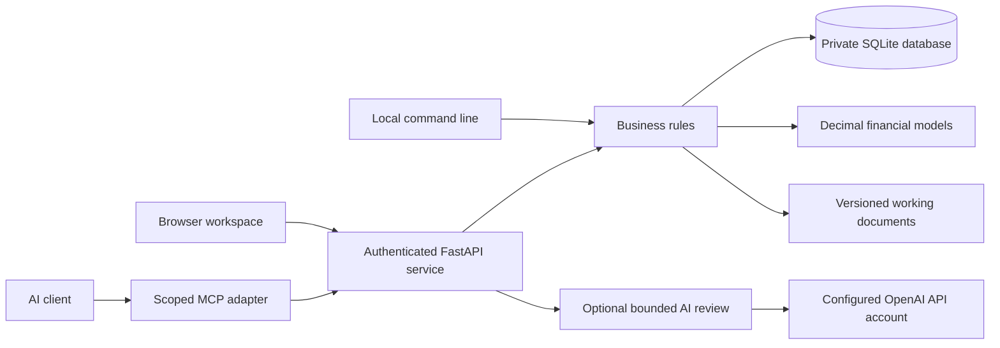
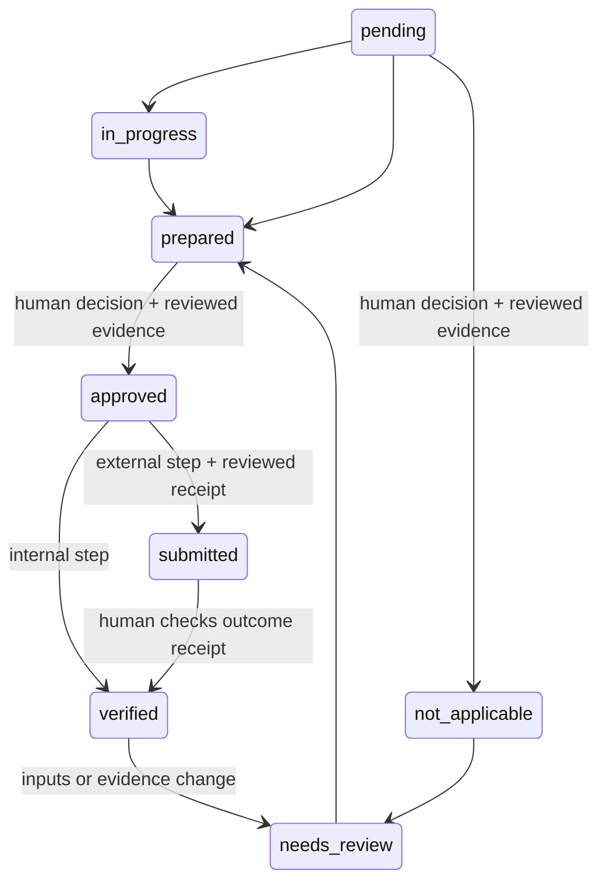

# Architecture and invariants

Business Foundry starts with the durable parts of a business: people and entities, customers, offers, resources and rights, responsibilities, obligations, decisions, evidence, work and money. Starting and acquiring both produce these records. Acquisition adds a target, an investment thesis, financial reconciliation, a transfer and an integration plan.

## Runtime

One Python process, SQLite with WAL, and static HTML/CSS/JavaScript are sufficient. No build service, vector database, message broker, cloud account or AI key is required. The wheel includes the interface. Monetary outputs use decimal strings. Provider model output never supplies financial arithmetic.

## Records and scope

A business workspace is a container, not proof that a legal entity exists. Entity, person, ownership and role records can describe an organization and connect through `related_ids`; they do not create entities, issue equity, enforce cap-table totals or grant application permissions. Application authority comes from access keys and their roles.

All objects have a business ID, type, title, state, version and timestamps. Related records and evidence must belong to the same business. Cross-business references are rejected even for an owner. Multiple legal entities can be described within a workspace; consolidated accounting and cross-workspace transaction accounting are not implemented.

| Layer | Contents |
|---|---|
| Facts and assumptions | Customers, offers, assets, contracts, obligations, people, entities, ownership, roles, decisions, risks |
| Evidence | Immutable text, source reference, effective date, SHA-256, human assessment |
| Work | Versioned planning guide, prerequisites, required record types, decisions and receipts |
| Models | Explicit inputs, deterministic results, calculation version, evidence links |
| Documents | Draft content, hash, source fingerprint and source IDs |
| Sales | Invoice draft, external issue attestation, payment receipts and remaining balance |
| History | Actor-attributed events, object revisions, local hash chain |

## State transitions

Preparation is allowed before prerequisites finish, so work can proceed in parallel. Approval, submission and verification require satisfied dependencies and required record types. An external step requires reviewed receipt evidence, not just a generated draft. An authorized reviewer assesses whether the actual content proves the actual outcome; software does not independently authenticate provider receipts. A single reviewer can both prepare and approve in v0.1; configurable separation of duties is future work.

A withdrawn source downgrades verified claims supported by it, flags affected invoices and payments, makes deal analyses stale, and reopens affected completed work and downstream steps. A completed step reopens when its current standing rests on the withdrawn source. That standing is the evidence attached to the step now, which always counts, together with the evidence cited since the step's last reopening: at its latest preparation and at every step after it, or, if it was not prepared in that round, at its last step. Within the step's own history, evidence cited only before the step was last reopened, or only at a preparation that a later preparation replaced, does not count. Such a source can still reopen the step in other ways: through a record it supports whose kind the step requires, or through another step this one depends on. The earlier citations are read from the step's history, so existing workspaces need no migration. A history entry that cannot be read is ignored and cannot stop a withdrawal. New or changed records reopen relevant completed work. Business-profile changes conservatively reopen completed steps. Reopening a step by hand reopens only the completed steps that depend on it, directly or through other steps. Documents retain their original content and expose staleness by comparing source fingerprints. Historical financial outputs are never rewritten.

The task catalog is versioned planning guidance. Its source-check date indicates reference review, not a jurisdiction-specific professional opinion. Existing tasks retain the original package data when application code changes. Jurisdiction changes require a new workspace in this release; silently replacing the legal context would destroy the basis for earlier decisions.

## Transaction and retry rules

Writes use `BEGIN IMMEDIATE` and commit the business change, revision, event and idempotency result together. The same actor/key/request returns the original result. Reusing a key with a changed request yields HTTP 409. Versioned updates reject stale versions. Duplicate payment references and overpayments fail within the same transaction.

Access-key creation is intentionally different: it returns a fresh secret once and does not persist the raw secret in the idempotency cache, so sending the same request again under the same key creates a second key. Review the key list before repeating a creation after a lost response; revoke unused keys. When the answer to a key creation is lost, the web interface says so in plain words: it cannot tell whether the key was created, a key that was created cannot be shown again, and the person should look for a key of that name in the access list, revoke it if they did not receive it, and then create a new one. It loads the access list again so the key can be seen, and offers no control that would send the creation again.

For every other command the interface sends, a lost answer is reported as what it is. A business command keeps its form open with the same `Idempotency-Key`, so sending the unchanged form again returns the recorded result; once that form has been closed, the interface says it cannot tell whether the change was saved and asks the person to check the records before entering it again. Revoking a key that is already revoked reports it revoked again, a second sign-out ends the session or is refused as signed out, and a second sign-in opens another session, so the interface says each of these is safe to repeat.

AI calls reserve a unique request and a daily-limit slot before the network request. The call is never automatically retried. Unknown transport outcomes remain `unknown`; process interruption can leave `pending`, also an unconfirmed outcome. Neither state grants authority. Successful advice must pass schema and known-record citation validation. Requests and responses remain available for inspection and export.

## Integrity and recovery

Events form a per-business SHA-256 chain. Verification also compares current objects with the last recorded snapshot, checks current revision snapshots, detects missing historical objects and checks evidence/document content hashes. This detects accidental or simple out-of-band modification. It does not provide nonrepudiation against a database administrator who can rewrite all local records and hashes. Protect off-machine backups or independently anchor exported head hashes for stronger guarantees.

JSON export is a portable inspection artifact containing records, events, documents and AI runs. It is not an authority-bearing import format. Restore uses a consistent SQLite backup, preserving IDs, history, keys and command receipts. Restoration refuses to overwrite an existing destination. Protect the owner key separately; its plaintext is never in the database.

## Repository map

- `src/foundry/models.py`: input contracts and numerical bounds.
- `src/foundry/store.py`: persistence, transactions, credentials, revisions and events.
- `src/foundry/service.py`: scopes, human decisions, dependencies and business operations.
- `src/foundry/finance.py`: linked statements, DCF and acquisition analysis.
- `src/foundry/documents.py`: grounded working documents.
- `src/foundry/catalog.py`: versioned work and reference sources.
- `src/foundry/api.py`, `cli.py`, `mcp_server.py`: three interfaces over the same rules.
- `src/foundry/ai.py`: optional provider review and request accounting.
- `src/foundry/static/`: responsive, dependency-free browser interface: a source list, a grouped list and an inspector, with each catalog group drawn as a coloured line on a Journey map generated from the step data. Every figure it shows as text is the server's decimal string, formatted for display and never recalculated; the one sign it reads from a figure (whether more cash is needed) comes from the decimal string's digits. The cash chart is the exception: it converts figures to numbers to place its points and to label its axis, so its shape and axis labels are approximate drawing, not figures to rely on; the exact figures are in the tables beside it. It never derives a state the records do not hold. A response is applied only while the business and the load it was requested for are still on screen, so a slow reply cannot show one business's records or history under another's name. Everything the interface waits for belongs to the session that started it, captured before the request is sent; after sign-out, a 401 or a new sign-in, a late answer changes nothing on the page, and a new access key that arrives then is discarded. A sign-out still waiting when the session ends another way is cancelled then, so its answer cannot delete the cookie of a session signed in after it in the same tab; one sent from another tab still can. Each form belongs to the business on screen when it opened and sends there, with the record ids and expected versions it was filled from, never with what is in memory when it is submitted. When the page changes to another business, a dialog or step decision form about the previous one is closed, and a form that sent nothing says it was closed without saving. The answer to a command that arrives while another business is shown, or about to be, is reported under its own business's name ("Saved to …", "Not saved to …") and does not mark that page out of date or change its view or focus. A new access key is never shown over an open dialog; it waits for that dialog to close, and a change of business does not close it. When a dialog closes, keyboard focus goes back to the control that opened it, or to the control drawn in its place if the page was redrawn meanwhile, else to the selected row or another visible resting place.
- `tests/`: independent financial expectations, authority and workflow failures, persistence and provider tests.
- `tests/browser.cjs`: actual browser creation, review, modeling, document and payment flows; the Journey map, distinct state glyphs, evidence withdrawal reopening work, phone and medium layouts, and the empty first run; keyboard focus and row roles; each line's computed colour in both themes; held-back responses arriving after a business switch, a save or a second refresh; late answers after sign-out, a new sign-in or a 401 (a new access key included), forms and views closed when another business loads, and results reported under their own business's name; lost answers to key creation and other commands; a sign-out answer held until after a 401 and a new sign-in; focus after the out-of-date notice is dismissed and after a dialog closes, including one whose page was redrawn while it was open; link schemes, markup-free money formatting, and sign-out clearing.
