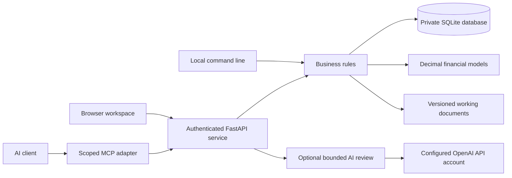
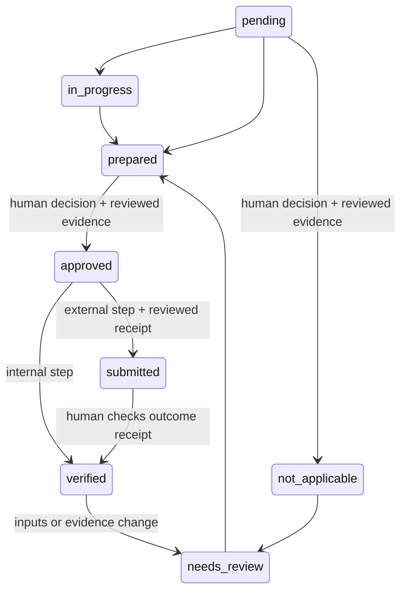

# Architecture and invariants

Business Foundry starts with the durable parts of a business: people and entities, customers, offers, resources and rights, responsibilities, obligations, decisions, evidence, work and money. Starting and acquiring both produce these records. Acquisition adds a target, an investment thesis, financial reconciliation, a transfer and an integration plan.

## Runtime

One Python process, SQLite with WAL, and static HTML/CSS/JavaScript are sufficient. No build service, vector database, message broker, cloud account or AI key is required. The wheel includes the interface. Monetary outputs use decimal strings. Provider model output never supplies financial arithmetic.

## Records and scope

A business workspace is a container, not proof that a legal entity exists. Entity, person, ownership and role records can describe an organization and connect through `related_ids`; they do not create entities, issue equity, enforce cap-table totals or grant application permissions. Application authority comes from access keys and their roles.

All objects have a business ID, type, title, state, version and timestamps. Related records and evidence must belong to the same business. Cross-business references are rejected even for an owner. Multiple legal entities can be described within a workspace; consolidated accounting and cross-workspace transaction accounting are not implemented.

| Layer | Contents |
|---|---|
| Facts and assumptions | Customers, offers, assets, contracts, obligations, people, entities, ownership, roles, decisions, risks |
| Evidence | Immutable text, source reference, effective date, SHA-256, human assessment |
| Work | Versioned planning guide, prerequisites, required record types, decisions and receipts |
| Models | Explicit inputs, deterministic results, calculation version, evidence links |
| Documents | Draft content, hash, source fingerprint and source IDs |
| Sales | Invoice draft, external issue attestation, payment receipts and remaining balance |
| History | Actor-attributed events, object revisions, local hash chain |

## State transitions

Preparation is allowed before prerequisites finish, so work can proceed in parallel. Approval, submission and verification require satisfied dependencies and required record types. An external step requires reviewed receipt evidence, not just a generated draft. An authorized reviewer assesses whether the actual content proves the actual outcome; software does not independently authenticate provider receipts. A single reviewer can both prepare and approve in v0.1; configurable separation of duties is future work.

A withdrawn source downgrades verified claims supported by it, flags affected invoices and payments, makes deal analyses stale, and reopens affected completed work and downstream steps. New or changed records reopen relevant completed work. Business-profile changes conservatively reopen completed steps. Reopening a step by hand reopens only the completed steps that depend on it, directly or through other steps. Documents retain their original content and expose staleness by comparing source fingerprints. Historical financial outputs are never rewritten.

The task catalog is versioned planning guidance. Its source-check date indicates reference review, not a jurisdiction-specific professional opinion. Existing tasks retain the original package data when application code changes. Jurisdiction changes require a new workspace in this release; silently replacing the legal context would destroy the basis for earlier decisions.

## Transaction and retry rules

Writes use `BEGIN IMMEDIATE` and commit the business change, revision, event and idempotency result together. The same actor/key/request returns the original result. Reusing a key with a changed request yields HTTP 409. Versioned updates reject stale versions. Duplicate payment references and overpayments fail within the same transaction.

Access-key creation is intentionally different: it returns a fresh secret once and does not persist the raw secret in the idempotency cache. Review the key list before repeating a creation after a lost response; revoke unused keys.

AI calls reserve a unique request and a daily-limit slot before the network request. The call is never automatically retried. Unknown transport outcomes remain `unknown`; process interruption can leave `pending`, also an unconfirmed outcome. Neither state grants authority. Successful advice must pass schema and known-record citation validation. Requests and responses remain available for inspection and export.

## Integrity and recovery

Events form a per-business SHA-256 chain. Every object version is written as one revision row and one chained event carrying the same snapshot; the business profile is versioned through events only and has no revision rows. `foundry verify`, the audit endpoint and exports check, for one business: the event chain hashes and links; that each current object and the business profile equal the newest chained snapshot for them; that the revision at each object's current version equals the object; that every stored revision of every version equals the snapshot in the chained event for the same object and version (when two chained events record the same object and version, the later one is used; adding such an event without breaking the chain means rewriting chain hashes, the administrator case below); that no chained object version lacks a revision and no revision exists for a version, or for the business profile, that no chained event records; that no chained object is missing from the current records; evidence/document content hashes; and that AI review records match their chained digests. Stored values are compared after parsing, strictly by JSON type and value, so `false` and `0`, `true` and `1`, or `1` and `1.0` are different. Two spellings of the same value are not told apart: whitespace, key order, string escapes, `1.0` and `1.00`, or the same JSON stored as a SQLite BLOB of its text bytes instead of as text. A revision snapshot is read as bytes, whatever its SQLite storage class, and decoded strictly in the database encoding (UTF-8 unless the file was created otherwise); a snapshot that cannot be decoded that way, starts with a byte-order mark, cannot be parsed, is a number or NULL, or holds `NaN` or `Infinity`, is reported as differing. A revision whose version is not an integer (a REAL equal to a whole number counts as that integer) matches no chained event and is reported as having no recorded history, its stored value shown as a short SQLite literal such as `CAST(X'FF7B' AS TEXT)`, and the version it held as missing. The `actor_id` and `created_at` columns of a revision row are not compared with anything. Revision rows are attributed to a business through its current objects and the object ids named by its events, so a row for an object id unknown to that business is not checked. An event, current record, business profile or AI review row that is not readable JSON stops verification with an error instead of a report. This detects accidental or simple out-of-band modification. It does not provide nonrepudiation against a database administrator who can rewrite all local records and hashes. Protect off-machine backups or independently anchor exported head hashes for stronger guarantees.

JSON export is a portable inspection artifact containing records, events, documents and AI runs. It is not an authority-bearing import format. Restore uses a consistent SQLite backup, preserving IDs, history, keys and command receipts. Restoration refuses to overwrite an existing destination. Protect the owner key separately; its plaintext is never in the database.

## Repository map

- `src/foundry/models.py`: input contracts and numerical bounds.
- `src/foundry/store.py`: persistence, transactions, credentials, revisions and events.
- `src/foundry/service.py`: scopes, human decisions, dependencies and business operations.
- `src/foundry/finance.py`: linked statements, DCF and acquisition analysis.
- `src/foundry/documents.py`: grounded working documents.
- `src/foundry/catalog.py`: versioned work and reference sources.
- `src/foundry/api.py`, `cli.py`, `mcp_server.py`: three interfaces over the same rules.
- `src/foundry/ai.py`: optional provider review and request accounting.
- `src/foundry/static/`: responsive, dependency-free browser interface.
- `tests/`: independent financial expectations, authority and workflow failures, persistence and provider tests.
- `tests/browser.cjs`: actual browser creation, review, modeling, document and payment flows.
