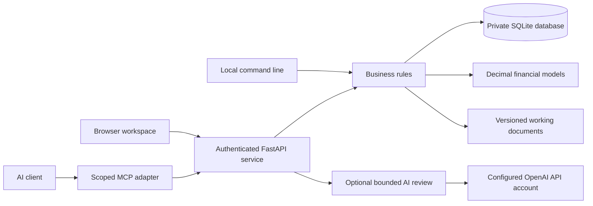
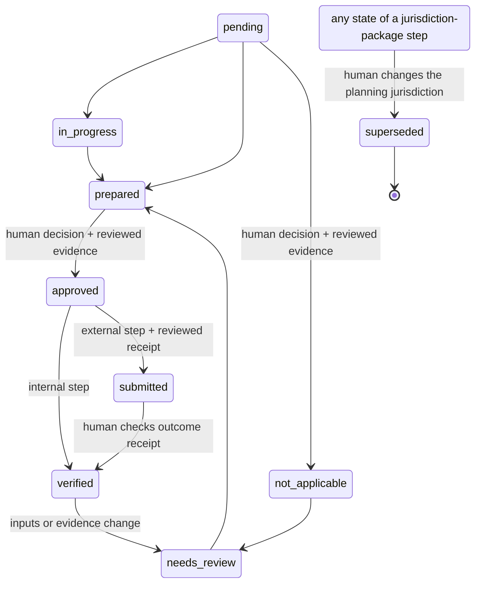

# Architecture and invariants

Business Foundry starts with the durable parts of a business: people and entities, customers, offers, resources and rights, responsibilities, obligations, decisions, evidence, work and money. Starting and acquiring both produce these records. Acquisition adds a target, an investment thesis, financial reconciliation, a transfer and an integration plan.

## Runtime

One Python process, SQLite with WAL, and static HTML/CSS/JavaScript are sufficient. No build service, vector database, message broker, cloud account or AI key is required. The wheel includes the interface. Monetary outputs use decimal strings. Provider model output never supplies financial arithmetic.

## Records and scope

A business workspace is a container, not proof that a legal entity exists. Entity, person, ownership and role records can describe an organization and connect through `related_ids`; they do not create entities, issue equity, enforce cap-table totals or grant application permissions. Application authority comes from access keys and their roles.

All objects have a business ID, type, title, state, version and timestamps. Related records and evidence must belong to the same business. Cross-business references are rejected even for an owner. Multiple legal entities can be described within a workspace; consolidated accounting and cross-workspace transaction accounting are not implemented.

| Layer | Contents |
|---|---|
| Facts and assumptions | Customers, offers, assets, contracts, obligations, people, entities, ownership, roles, decisions, risks |
| Evidence | Immutable text, source reference, effective date, SHA-256, human assessment |
| Work | Versioned planning guide, prerequisites, required record types, decisions and receipts |
| Models | Explicit inputs, deterministic results, calculation version, evidence links |
| Documents | Draft content, hash, source fingerprint, source IDs and the date overdue standing was worked out for (`as_of`) |
| Sales | Invoice draft, external issue attestation, payment receipts and remaining balance |
| History | Actor-attributed events, object revisions, local hash chain |

## State transitions

Preparation is allowed before prerequisites finish, so work can proceed in parallel. Approval, submission and verification require satisfied dependencies and required record types. An external step requires reviewed receipt evidence, not just a generated draft. An authorized reviewer assesses whether the actual content proves the actual outcome; software does not independently authenticate provider receipts. A single reviewer can both prepare and approve in v0.1; configurable separation of duties is future work.

A withdrawn source downgrades verified claims supported by it, flags affected invoices and payments, makes deal analyses stale, and reopens affected completed work and downstream steps. A completed step reopens when its current standing rests on the withdrawn source. That standing is the evidence attached to the step now, which always counts, together with the evidence cited since the step's last reopening: at its latest preparation and at every step after it, or, if it was not prepared in that round, at its last step. Within the step's own history, evidence cited only before the step was last reopened, or only at a preparation that a later preparation replaced, does not count. Such a source can still reopen the step in other ways: through a record it supports whose kind the step requires, or through another step this one depends on. The earlier citations are read from the step's history, so existing workspaces need no migration. A history entry that cannot be read is ignored and cannot stop a withdrawal. New or changed records reopen relevant completed work. Business-profile changes conservatively reopen completed steps. Reopening a step by hand reopens only the completed steps that depend on it, directly or through other steps. Documents retain their original content. In the snapshot each carries `stale` and `stale_reasons`: `source_changed` when its source fingerprint no longer matches; for a readiness report also `overdue_changed`, with `as_of` and `today`, when an obligation's overdue standing on the snapshot's `as_of` differs from its standing on the date stored with the report, or `as_of_unreadable` when that stored date cannot be read. A document stored without a date is marked by its fingerprint alone. `as_of` is the calendar date of the computer running the server, read once for each snapshot. Historical financial outputs are never rewritten.

The task catalog is versioned planning guidance. Its source-check date indicates reference review, not a jurisdiction-specific professional opinion. Existing tasks retain the original package data when application code changes.

The planning jurisdiction changes only through its own human decision, never through a general business edit. An owner or reviewer records a reason, and optionally reviewed evidence of the same business, against the current business version (`POST /api/businesses/{id}/jurisdiction`, or `foundry jurisdiction`). Agent, operator and viewer keys are refused, and the agent adapter has no tool for it. In one transaction the change moves the current package's steps, in whatever state they are, to the terminal `superseded` state with a history entry naming both jurisdictions and the actor; adds the new package's steps as new pending steps whose prerequisites resolve by catalog key against the steps that remain (a new local review depends on the existing structure decision); and reopens every remaining completed step, deal steps included, with the note "Jurisdiction changed from X to Y". Base and deal steps keep their identity and are never superseded. Package steps are recognised by catalog key, so existing workspaces need no migration. Any of the known jurisdictions can follow any other, including a return to `undecided`; each change adds fresh steps rather than reviving superseded ones. Nothing is deleted or rewritten: superseded steps keep their full history and stay in the snapshot and exports. They never transition again, never block another step, are never reopened, and are excluded from readiness counts (`stats.tasks` and the state counts; `stats.superseded` counts them separately) and from the work lists of generated documents. The readiness report, the business plan and the operating manual name them in one line, as replaced steps, and list them nowhere else; the reference index of each gives the id of each one it names. The other documents never name them: the structure decision brief and the customer contract brief count no steps, and the investment memo counts only its acquisition's steps, which are never superseded. Earlier documents become stale. Earlier deal analyses and forecasts are marked as well. In the snapshot every deal and forecast carries `stale` and `stale_reasons`, a list in which each reason has a `code` and a `message`, one plain sentence: `evidence_changed` when a deal's cited evidence has changed since it was saved, and `jurisdiction_changed`, which also gives `saved_jurisdiction` and `current_jurisdiction`, when the planning jurisdiction in force now differs from the one in force when the record was saved. A deal can carry both. Generated documents print each reason's sentence as a warning directly above the figures it concerns, and the browser interface shows the same sentences. The jurisdiction a record was saved under is worked out from the event log each time the snapshot is read: it is the `to` of the latest `business.jurisdiction_changed` event before the record's `deal.created` or `financial_plan.created` event, or the `from` of the first change if the record came before any change. Order is the event sequence, never clock time. A deal or forecast is calculated once, when it is saved, and nothing changes it afterwards. Nothing is stored or rewritten, so records saved before this mark existed are covered without a migration, and a business with no jurisdiction change in its history has no record marked for this reason. A newly saved analysis or forecast has no mark; an earlier one stays marked until the planning jurisdiction returns to the one it was saved under. The jurisdiction mark blocks no step: the change has already reopened every completed step, so each decision is taken again with the mark in view, and the calculations take no jurisdiction input, so requiring a founder to re-enter an unchanged analysis first would cost effort for no gain. Changed evidence still blocks a deal's steps. A save that is committed after the change counts as saved under the new jurisdiction, even if whoever sent it had not yet seen the change. The event log records the decision (`business.jurisdiction_changed`, with from, to, reason, evidence and the affected steps) alongside each superseded, added and reopened step. `GET /api/businesses/{id}/jurisdiction/preview?to=...`, open to any key that can read the business, returns what the change would supersede, add and reopen; it uses the same planning function as the change. A jurisdiction change selects which planning guide applies. It is not legal advice and does not form, move or register an entity.

## Transaction and retry rules

Writes use `BEGIN IMMEDIATE` and commit the business change, revision, event and idempotency result together. The same actor/key/request returns the original result. Reusing a key with a changed request yields HTTP 409. Versioned updates reject stale versions. Duplicate payment references and overpayments fail within the same transaction.

Access-key creation is intentionally different: it returns a fresh secret once and does not persist the raw secret in the idempotency cache. Review the key list before repeating a creation after a lost response; revoke unused keys.

AI calls reserve a unique request and a daily-limit slot before the network request. The call is never automatically retried. Unknown transport outcomes remain `unknown`; process interruption can leave `pending`, also an unconfirmed outcome. Neither state grants authority. Successful advice must pass schema and known-record citation validation. Requests and responses remain available for inspection and export.

## Integrity and recovery

Events form a per-business SHA-256 chain. Every object version is written as one revision row and one chained event carrying the same snapshot; the business profile is versioned through events only and has no revision rows. An event records a version when its payload's `id` is the event's object id, the payload has `data`, and its `version` is a JSON integer. Walking the chain in order, the first event that records an object or the business profile at a given version stands for that version, and no later event replaces it. An event whose payload `id` is not its own object id is not a snapshot of any record. It records no version, whatever its `version`, and it is never the newest chained snapshot that a current record is compared with. Its object id still counts among the object ids named by the business's events, which attribute revision rows to the business. It still counts for an AI review when its payload has a `run_id` and a `data_sha256` and neither is `null`, `false`, zero, `""`, `[]` or `{}`; an event that does not count leaves the last one that did standing for that run. `foundry verify`, the audit endpoint and exports check, for one business: the event chain hashes and links; that each current object and the business profile equal the newest chained snapshot for them, which is the last event whose own object id is their `id` and whose payload has that `id`, a `version` of any type and `data`; that the revision at each object's current version equals the object; that every stored revision of every version equals the snapshot in the event that stands for the same object and version; that no chained object version lacks a revision and no revision exists for a version, or for the business profile, that no chained event records; that no version of an object or of the business profile is recorded by more than one event, reported once per version as `Version recorded more than once in history`; that no event that would record a version has a `version` that is not a JSON integer, such as `2.0`, `2e0`, `true`, `"2"`, null, a list or an object, reported once per id as `History records an unusable version`, and such an event stands for no version; that no chained object is missing from the current records; evidence/document content hashes; and that AI review records match their chained digests. These messages appear in a fixed order: for each current record in turn, the business profile first, its current-record, content-hash and current-revision messages; then chained objects missing from the current records; then repeated and unusable versions, in the chain order of the event that first causes each; then revision rows, by object id and stored version, followed by recorded versions without a revision, in chain order; then AI reviews. Stored values are compared after parsing, strictly by JSON type and value, so `false` and `0`, `true` and `1`, `1` and `1.0`, or `0.0` and `-0.0` are different. Two spellings of the same value are not told apart: whitespace, key order, string escapes, `1.0` and `1.00`, `-0` and `0`, a key given twice, which is read as its last value, or the same JSON stored as a SQLite BLOB of its text bytes instead of as text. A revision snapshot is read as bytes, whatever its SQLite storage class, and decoded strictly in the database encoding (UTF-8 unless the file was created otherwise); a snapshot that cannot be decoded that way, starts with a byte-order mark, cannot be parsed, is a number or NULL, or holds `NaN` or `Infinity`, is reported as differing. An object revision whose version is stored as TEXT, BLOB or NULL matches no chained event and is reported as having no recorded history, with the stored value shown in SQLite notation, such as `CAST(X'FF7B' AS TEXT)`, and cut short when long; a recorded version that such a row replaced is reported as missing. SQLite stores a `NaN` bound as a number as NULL. A REAL version equal to a whole number counts as that integer. The `actor_id` and `created_at` columns of a revision row are not compared with anything. Revision rows are attributed to a business through its current objects and the object ids named by its events, so a row for an object id unknown to that business is not checked. Stored values stop verification with an error instead of a report in the following cases, and in no others. Below, *unencodable* JSON is JSON that Python parses but the chain's encoding refuses: it holds `NaN`, `Infinity`, `-Infinity` or a number too large for a float, such as `1E400`, or an unpaired surrogate, which is an escape such as `\ud800` in a value or a key, or its raw bytes in JSON stored as a BLOB, or it is nested just deep enough to parse but not to encode. Whatever the state of the chain: any column of an event, the business profile, a current record or an AI review row of this business holds text that is not valid in the database encoding; an event payload, or the data of the business profile or of a current record, is NULL or cannot be parsed, which includes an integer of more than 4,300 digits and nesting of about 1,000 levels on Python 3.11 or 10,000 on 3.12 and 3.13; an event payload is JSON but not an object; an event payload has a non-empty list or object as its `run_id` and a `data_sha256` that is present and not `false`, `null`, zero, `""`, `[]` or `{}`; an event has a NULL `object_id` and a payload with `version` and `data` but no `id`; or the data of a current evidence or document record is not an object holding a `content_sha256` and a text `content` without an unpaired surrogate. For an AI review row whose state equals the state in the newest chained event for it, or that has no chained event and a NULL state: its data is NULL, cannot be parsed or is unencodable. For an event the chain check hashes, which is one whose own `prev_hash` and every earlier event's `prev_hash` and `hash` are right, whatever its own `hash`: its payload is unencodable, or its `actor_id`, `action`, `object_id` or `created_at` is a BLOB or an infinite REAL. Otherwise these values are reported: unencodable JSON, a BLOB or an infinite REAL in an event the chain check does not hash, which shows the chain broken at or before that event; unencodable JSON in the data of the business profile or a current record, other than in evidence or document `content`; a BLOB, NULL or infinite REAL in their other columns; any other value in an AI review row; and any value in a revision row. Data that is JSON but not an object is compared like any other value, except in evidence and document records. An export also stops when something it carries cannot be written as JSON: a BLOB or an infinite REAL in any column it includes, unencodable JSON anywhere, or AI review data that cannot be parsed, whatever its state. The audit endpoint, which also returns every event, also stops when any event holds `NaN`, an infinite number or an unpaired surrogate, has a BLOB column that is not valid UTF-8, or has a payload nested about 1,000 levels deep. Changing an event, or removing one that has later events, breaks the chain unless every hash from that point onward is rewritten, the administrator case below; removing only the newest events leaves a shorter chain that still links, which the record checks above may then report as differences. The chain does not show who added an event or that the application wrote it. Anyone who can write to the database can append a correctly chained event without changing any earlier hash, so a head hash anchored before the append is still in the chain afterwards. An appended event that repeats a recorded version, or has an unusable version, is reported as above. An appended event that records a new version, together with a matching current record and, for an object, a matching revision row, verifies like an application write. An AI review row can be changed and still verify if an event carrying its new state and digest is appended, because each AI review is compared with the newest chained event for it. This detects accidental or simple out-of-band modification. It does not provide nonrepudiation against a database administrator who can rewrite all local records and hashes. Protect off-machine backups or independently anchor exported head hashes for stronger guarantees; an anchored head hash still in the chain shows that the events up to it are unchanged, not that later events came from the application.

JSON export is a portable inspection artifact containing records, events, documents and AI runs. It is not an authority-bearing import format. Restore uses a consistent SQLite backup, preserving IDs, history, keys and command receipts. Restoration refuses to overwrite an existing destination. Protect the owner key separately; its plaintext is never in the database.

## Repository map

- `src/foundry/models.py`: input contracts and numerical bounds.
- `src/foundry/store.py`: persistence, transactions, credentials, revisions and events.
- `src/foundry/service.py`: scopes, human decisions, dependencies and business operations.
- `src/foundry/finance.py`: linked statements, DCF and acquisition analysis.
- `src/foundry/documents.py`: grounded working documents.
- `src/foundry/catalog.py`: versioned work and reference sources.
- `src/foundry/api.py`, `cli.py`, `mcp_server.py`: three interfaces over the same rules.
- `src/foundry/ai.py`: optional provider review and request accounting.
- `src/foundry/static/`: responsive, dependency-free browser interface.
- `tests/`: independent financial expectations, authority and workflow failures, persistence and provider tests.
- `tests/browser.cjs`: actual browser creation, review, modeling, document and payment flows.
